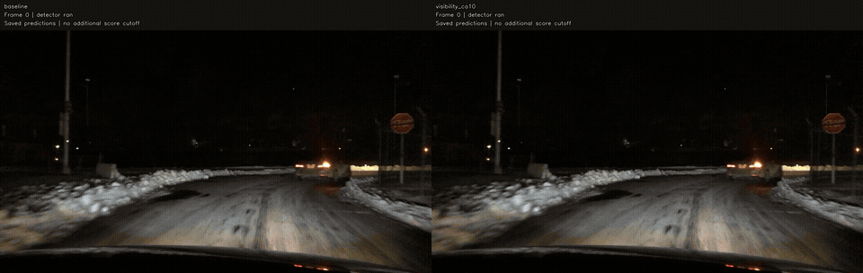
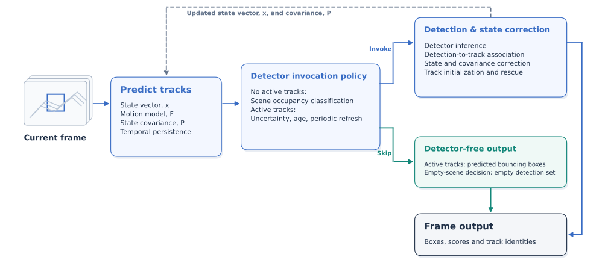
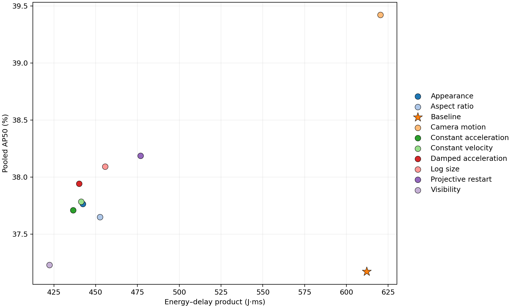
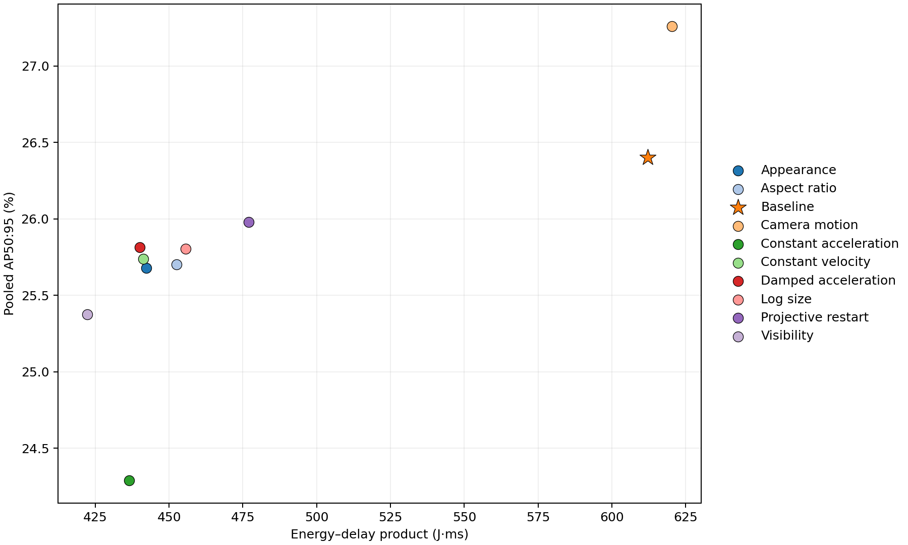
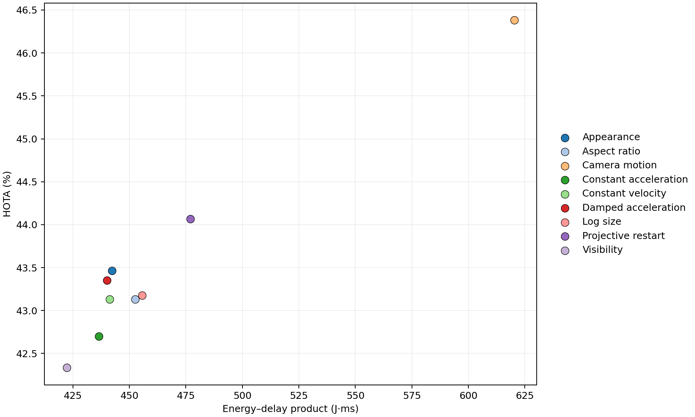
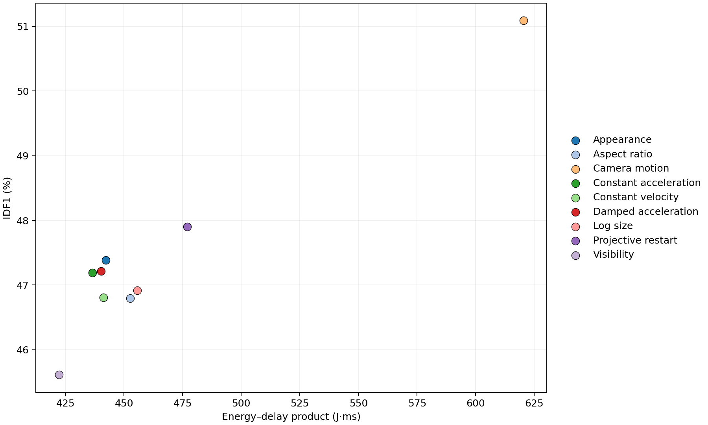
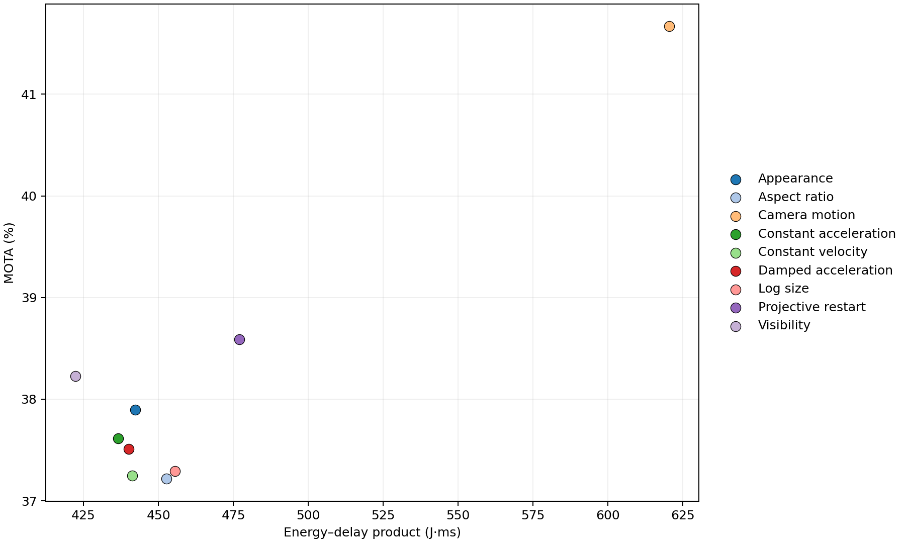
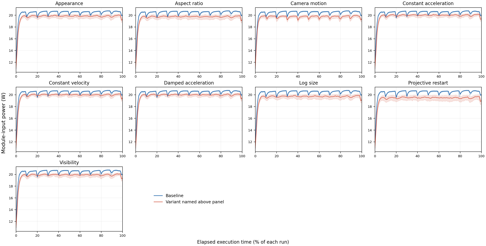
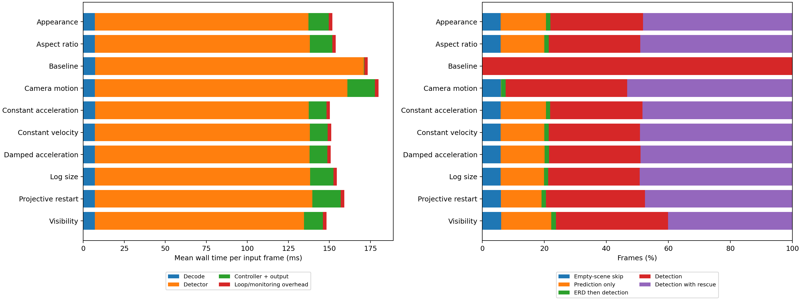

# FrameVigil

**Accuracy, latency and energy trade-offs in video object detection through selective detector invocation and temporal tracking**

FrameVigil explores the trade-off between detection accuracy and computational cost in adaptive inference for video object detection: when skipping detector calls saves time and power draw, and how this affects detection and tracking accuracy. It compares motion models, output strategies and tracking extensions against a detector that runs on every frame.

The study is done with YOLO11x, YOLO26x and RT-DETRv2 R50-vd, with TensorRT inference and TF32 arithmetic policy.

<p align="center">
  <a href="assets/demo.mp4">
    
  </a>
</p>

<p align="center">
  <strong>Left:</strong> Baseline &nbsp; · &nbsp;
  <strong>Right:</strong> Visibility
</p>

On this selected 202-frame clip, one of the motion models, visibility, invokes the detector **113 times** (**44.1% skipped**) with **66.38% AP50**, versus **202 calls** and **67.70% AP50** for baseline. Visibility uses **18.40 W** mean module-input power, **2.111 J/frame**, and **114.77 ms/frame** mean pipeline latency; baseline uses **20.41 W**, **3.525 J/frame**, and **172.66 ms/frame**.

The full 40.4-second sequence plays at the dataset's 5 Hz sampling rate. Headers indicate whether the detector ran.
## Overview

The controller predicts tracks and invokes detection based on scene occupancy, uncertainty and elapsed-frame limits. Between detector calls, it outputs predicted boxes; eligible unmatched tracks are retained temporarily.

[](assets/system.svg)

The controller chooses between detector updates and prediction-only or empty-scene output. Motion models, association and rescue, and output strategies are the components compared in the study.

## Variant Reference

| Configuration name | Change |
|---|---|
| `baseline` | Detector on every frame; no temporal identity association. |
| `constant_acceleration` | Adaptive scheduling with a constant-acceleration Kalman filter. |
| `cv8` | Constant-velocity motion model. |
| `damped_ca10` | Damped acceleration model. |
| `log_cv8` | Constant velocity with logarithmic box sizes. |
| `aspect_cv8` | Constant velocity with aspect-ratio and height coordinates. |
| `projective_restart_cv8` | Relative-depth representation; restart invalid corrected states. |
| `camera_ca10` | Compensate camera motion using sparse optical flow and RANSAC. |
| `appearance_ca10` | Use HSV appearance histograms during association. |
| `visibility_ca10` | Use visibility and existence estimates to restrict unmatched-track rescue. |

The motion and tracking extensions emit detector observations for matched detections and track predictions for skipped or rescued outputs.

## Results

**200 BDD100K MOT validation videos · 39,973 frames** Measured on a Jetson Orin Nano Super with locked clocks, YOLO26x, TensorRT, TF32 arithmetic policy, NMS-free output and a `1 × 3 × 736 × 1280` FP32 input.

| Variant | AP50 (%) ↑ | AP50:95 (%) ↑ | Mean latency (ms/frame) ↓ | P95 latency (ms) ↓ | Energy (J/frame) ↓ | EDP (J·ms) ↓ |
|---|---:|---:|---:|---:|---:|---:|
| Baseline | 37.17 | 26.40 | 173.36 | 173.70 | 3.531 | 612.20 |
| Constant acceleration | 37.71 | 24.29 | 150.33 | 185.03 | 2.904 | 436.48 |
| Constant velocity | 37.78 | 25.74 | 151.12 | 185.17 | 2.920 | 441.32 |
| Damped acceleration | 37.94 | 25.81 | 150.89 | 185.07 | 2.917 | 440.16 |
| Log size | 38.09 | 25.80 | 154.56 | 194.75 | 2.948 | 455.59 |
| Aspect ratio | 37.65 | 25.70 | 153.93 | 193.50 | 2.940 | 452.60 |
| Projective restart | 38.19 | 25.98 | 159.05 | 205.29 | 2.999 | 476.90 |
| Camera motion | 39.42 | 27.26 | 179.91 | 191.79 | 3.448 | 620.37 |
| Appearance | 37.76 | 25.68 | 151.81 | 189.61 | 2.913 | 442.29 |
| Visibility | 37.23 | 25.38 | 148.21 | 187.61 | 2.849 | 422.29 |

Visibility has the lowest EDP: **31.02% below baseline**, with **+0.06 percentage points AP50** and **−1.03 points AP50:95**. Camera motion has the highest accuracy on both metrics, but increases EDP by **1.33%**. Every adaptive variant uses less energy per frame with higher P95 latency than the baseline.

Energy is measured at the module input (`VDD_IN`).
**EDP = J/frame × mean ms/frame**
Both means calculated from totals including detector-skipped frames. One repeat does not establish run-to-run uncertainty.

<p align="center">
  <a href="assets/accuracy_edp_ap50.png"></a>
  <a href="assets/accuracy_edp.png"></a>
</p>

**Fig. 1.** Detection accuracy versus EDP over 200 clips: AP50 (left) and AP50:95 (right). Each point is one variant; upper-left is better.

### Tracking results

| Variant | HOTA (%) ↑ | IDF1 (%) ↑ | MOTA (%) ↑ |
|---|---:|---:|---:|
| Baseline | — | — | — |
| Constant acceleration | 42.70 | 47.19 | 37.61 |
| Constant velocity | 43.13 | 46.81 | 37.25 |
| Damped acceleration | 43.35 | 47.21 | 37.51 |
| Log size | 43.18 | 46.92 | 37.29 |
| Aspect ratio | 43.13 | 46.80 | 37.22 |
| Projective restart | 44.07 | 47.90 | 38.59 |
| Camera motion | 46.38 | 51.09 | 41.67 |
| Appearance | 43.47 | 47.39 | 37.89 |
| Visibility | 42.34 | 45.62 | 38.23 |

Baseline tracking metrics are unavailable because it does not associate object identities across frames.

<p align="center">
  <a href="assets/hota_edp.png"></a>
  <a href="assets/idf1_edp.png"></a>
</p>
<p align="center">
  <a href="assets/mota_edp.png"></a>
</p>

**Fig. 2.** Tracking quality versus EDP over 200 clips: HOTA (top left), IDF1 (top right), and MOTA (bottom). Each figure compares nine adaptive variants; upper-left is better.

### Power results

| Variant | Mean power (W) ↓ | Power reduction (%) ↑ | Energy reduction (%) ↑ | EDP reduction (%) ↑ |
|---|---:|---:|---:|---:|
| Baseline | 20.37 | 0.00 | 0.00 | 0.00 |
| Constant acceleration | 19.31 | 5.18 | 17.78 | 28.70 |
| Constant velocity | 19.33 | 5.12 | 17.30 | 27.91 |
| Damped acceleration | 19.33 | 5.10 | 17.40 | 28.10 |
| Log size | 19.07 | 6.37 | 16.53 | 25.58 |
| Aspect ratio | 19.10 | 6.23 | 16.74 | 26.07 |
| Projective restart | 18.85 | 7.44 | 15.09 | 22.10 |
| Camera motion | 19.17 | 5.91 | 2.35 | -1.33 |
| Appearance | 19.19 | 5.78 | 17.50 | 27.75 |
| Visibility | 19.22 | 5.62 | 19.31 | 31.02 |

Positive reductions indicate savings relative to baseline; negative values indicate an increase.

[](assets/power_aggregate.png)

**Fig. 3. Module-power profiles.** Lines show the median and shading the 25th–75th percentiles across 200 paired clips, with equal clip weights and one repeat. Each run is normalized to its own duration; positions do not align video frames.

[](assets/timing_and_decisions.png)

**Fig. 4. Processing time and frame decisions across 200 clips.** Left: mean time per input frame, separated into decoding, detector execution, controller/output and loop/monitoring overhead. Right: the percentage of frames assigned to each processing state. Empty-scene skip and prediction-only frames avoid detector invocation; detection with rescue includes predicted outputs for eligible unmatched tracks.

## Reproduce an experiment

Use Linux, Python 3.10+ and an NVIDIA CUDA GPU for measurement. TensorRT requires compatible NVIDIA Python bindings (10+); on Jetson, use the platform's NVIDIA software stack. The energy workflow below requires readable `VDD_IN` telemetry.

### 1. Install and download inputs

```bash
git clone https://github.com/Sauravrp67/FrameVigil.git
cd FrameVigil
bash scripts/setup.sh
source .venv/bin/activate

bash scripts/download_models.sh
bash scripts/prepare_dataset.sh
```

The model downloader fetches all three detectors and the shared empty-scene classifier. Use `--detector yolo26x` to download only that detector plus the classifier. Dataset preparation downloads the complete 200-video validation split.

### 2. Select the study and build the engine

Edit [configs/study.yaml](configs/study.yaml). For the 200-video YOLO26x NMS-free experiment, retain its full variant list and use:

```yaml
dataset:
  images: data/bdd100k/images/track/val
  labels: data/bdd100k/labels/box_track_20/val
  sequence:
    start: 0
    end: 200

experiment:
  variants: [baseline, constant_acceleration, cv8, damped_ca10,
             log_cv8, aspect_cv8, projective_restart_cv8, camera_ca10,
             appearance_ca10, visibility_ca10]
  repeats: 1

inference:
  model: yolo26x
  backend: tensorrt
  precision: tf32
  nms: none
```

Sequence indices select alphabetically sorted videos; `end` is exclusive. Use `end: 5` for a small trial run. For PyTorch eager, set `backend: torch` and omit the engine-build command. YOLO11x supports `native` or `custom` NMS; use `none` for YOLO26x one-to-one output and RT-DETRv2.

```bash
python scripts/build_detector_engine.py --config configs/study.yaml

python scripts/prepare_evaluation_dataset.py \
  --config configs/study.yaml --output outputs/dataset.json

python scripts/prepare_experiment.py \
  --experiment outputs/yolo26x_tf32_nmsfree_full \
  --dataset-manifest outputs/dataset.json \
  --config configs/study.yaml
```

Build the engine on the measurement GPU.

### 3. Validate power and measure

```bash
python scripts/validate_power.py --experiment outputs/yolo26x_tf32_nmsfree_full

sudo -v
python scripts/measure_experiment.py \
  --experiment outputs/yolo26x_tf32_nmsfree_full \
  --power vdd_in --lock-clocks
```

On a GPU without `VDD_IN`, skip power validation and use `--power none`; energy results will be unavailable. Clock locking uses `jetson_clocks` on Jetson and `nvidia-smi` on other supported NVIDIA GPUs. Omit `--lock-clocks` when clock control is unavailable.

### 4. Generate tables and figures

```bash
python scripts/summarize_experiment.py \
  --experiment outputs/yolo26x_tf32_nmsfree_full \
  --output outputs/yolo26x_tf32_nmsfree_full/summary

python scripts/plot_tradeoffs.py \
  --input outputs/yolo26x_tf32_nmsfree_full/summary/summary.csv \
  --output outputs/yolo26x_tf32_nmsfree_full/figures
```

`summarize_experiment.py` requires all scheduled trials. Plotting reads the generated CSVs and requires a new figure directory.

To render a side-by-side video from saved predictions (requires FFmpeg and ffprobe):

```bash
python scripts/render_demo.py \
  --dataset-manifest outputs/yolo26x_tf32_nmsfree_full/manifests/dataset.json \
  --video b255cd6c-0bdf0ac7 \
  --predictions \
    outputs/yolo26x_tf32_nmsfree_full/results/live/r0_baseline_b255cd6c-0bdf0ac7.json.gz \
    outputs/yolo26x_tf32_nmsfree_full/results/live/r0_visibility_ca10_b255cd6c-0bdf0ac7.json.gz \
  --output outputs/yolo26x_tf32_nmsfree_full/demo
```

This writes `comparison.mp4` and `preview.png`. Both the embedded animation and linked video include all 202 frames of the selected clip.

## Outputs and implementation

| Output | Contents |
|---|---|
| `manifests/freeze.json` | Selected variants, videos, inference settings and schedule. |
| `results/live/` | Compressed per-trial predictions, decisions and timings. |
| `results/power/` | Per-trial module-power samples. |
| `results/environment.json`, `results/clocks/` | Runtime versions and clock records. |
| `summary/accuracy_cost.csv` | AP50:95, mean/P95 latency, J/frame and EDP. |
| `summary/tracking.csv` | HOTA, IDF1 and MOTA. |
| `summary/power_comparison.csv` | Mean power, J/frame, EDP and reductions relative to baseline. |
| `summary/per_video.csv`, `summary/frames.csv` | Per-video metrics and frame-level diagnostics. |
| `figures/` | Diagnostic PNG/SVG figures, including aggregate power comparisons. |

## Scope and acknowledgements

Evaluation maps seven BDD categories into six COCO classes, merging pedestrian and rider, with `maxDets=300`. This is a project specific protocol unrelated to the official BDD100K tracking leaderboard. Baseline tracking metrics are unavailable because the detector-only baseline does not associate identities across frames.  Power-plot percentile bands describe variation across clips. Normalized execution time does not align video frames.

The adaptive controller and empty-scene classifier build on [Albireo](https://github.com/amirtaherin/albireo), with attribution retained in the source. Detector implementations and weights come from Ultralytics and RT-DETRv2; evaluation uses BDD100K annotations, pycocotools and TrackEval. Their respective licenses and dataset terms apply.

## License and citation

FrameVigil is licensed under [AGPL-3.0-only](LICENSE). Adapted code retains its
upstream notices; see [NOTICE.md](NOTICE.md). Model weights and dataset imagery
remain subject to their upstream terms.

If you use FrameVigil in your research, please cite the software using
[CITATION.cff](CITATION.cff) or GitHub's **Cite this repository** option, and identify
the version or commit used. Please also acknowledge the upstream methods and
datasets used in your experiments.
